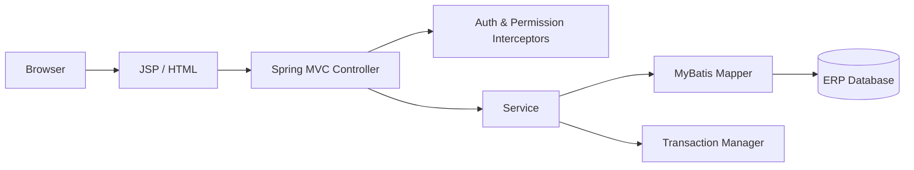
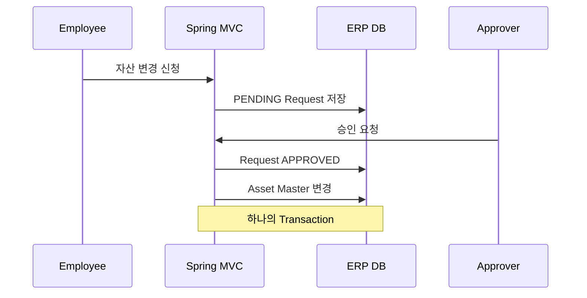

# Enterprise ERP Portal

> 영업·자재·회계 업무를 하나의 웹 포털에서 처리하는 **Spring MVC + JSP + MyBatis 기반 공개용 ERP 포트폴리오 프로젝트**입니다.

실제 기업 ERP 웹 시스템 개발 경험에서 얻은 **업무 흐름과 기술적 경험을 일반화해 새로 설계·구현**했습니다. 특정 회사의 원본 소스, 내부 DB 구조, 프로시저, 계정, 로고, 고객/직원 데이터는 포함하지 않습니다.

## 프로젝트에서 보여주는 것

- Spring Boot가 아닌 **전통적인 Spring MVC / WAR / Tomcat 계열 구조**
- JSP 기반 Server Side Rendering과 Controller-Service-Mapper 계층
- MyBatis를 이용한 ERP SQL 분리
- 사용자별 **프로그램 권한**을 Custom Interceptor로 공통 검증
- 고정자산 **변경 신청 → 승인/반려 → Master 반영** Workflow
- 승인 상태 변경과 Master 갱신을 하나의 `@Transactional` 처리
- H2 Demo DB로 별도 ERP DB 없이 실행 가능
- 설정값을 System Property로 Override하여 MSSQL 환경에도 연결 가능한 구조

## 대표 기능

| 업무 영역 | 기능 |
|---|---|
| Dashboard | 영업 목표/실적, 저재고, 승인대기, 실사필요 현황 |
| 영업 | 월/부서 기준 목표·실적 및 달성률 조회 |
| 자재 | 품목/창고별 현재고·예약·가용재고 조회 |
| 회계/고정자산 | 자산 Master 조회, 변경 신청, 승인/반려, 실사 등록 |
| 권한 | 사용자별 Program Permission 기반 접근 제어 |

## Architecture



## 고정자산 변경 Workflow



## Tech Stack

`Java 8 target` · `Spring Framework 5.3` · `Spring MVC` · `JSP/JSTL` · `MyBatis` · `Maven` · `WAR` · `H2 Demo DB` · `MSSQL Driver`

## 실행 방법

요구사항: JDK 17 이상 실행 환경 + Maven 3.8+

```bash
mvn clean test
mvn jetty:run
```

브라우저:

```text
http://localhost:8080/login
```

### Demo 계정

| 계정 | 비밀번호 | 권한 |
|---|---|---|
| `admin` | `admin1234` | 전체 기능 + 자산 승인 |
| `employee` | `user1234` | 조회/변경신청/실사, 승인 불가 |

Health Check:

```text
GET http://localhost:8080/api/health
```

## DB 전환

기본값은 별도 설치가 필요 없는 H2 In-Memory DB입니다. `database.properties`의 키는 JVM System Property로 Override할 수 있습니다.

```bash
mvn jetty:run \
  -Ddb.driver=com.microsoft.sqlserver.jdbc.SQLServerDriver \
  -Ddb.url="jdbc:sqlserver://localhost:1433;databaseName=erp_demo;encrypt=true;trustServerCertificate=true" \
  -Ddb.username=erp_user \
  -Ddb.password=YOUR_PASSWORD
```

실제 Credential은 Git에 저장하지 않습니다.

## 프로젝트 구조

```text
src/main/java/io/portfolio/erp
├─ domain
├─ mapper
├─ security
├─ service
└─ web

src/main/resources
├─ db
├─ mapper
└─ spring

src/main/webapp
├─ resources/css
└─ WEB-INF/views
```

## Portfolio Notes

이 프로젝트는 화면 디자인 자체보다 **기업 ERP 업무 구조, 기존 Spring MVC 유지보수 경험, MyBatis 기반 데이터 처리, 권한과 승인 Workflow**를 보여주는 데 목적이 있습니다.

보다 자세한 설명은 [`PORTFOLIO.md`](PORTFOLIO.md), [`docs/architecture.md`](docs/architecture.md), [`docs/reviewer-guide.md`](docs/reviewer-guide.md)를 참고해주세요.

## Security

- 실제 회사 계정/DB 주소/API Key를 포함하지 않습니다.
- Demo 비밀번호는 PBKDF2-HMAC-SHA256 Hash로 저장합니다.
- 원본 프로젝트의 사내 프로그램 코드/테이블/프로시저/브랜드 리소스는 포함하지 않습니다.
- 공개용 프로젝트는 원본 소스의 복사본이 아니라 경험을 바탕으로 별도 구현한 프로젝트입니다.
